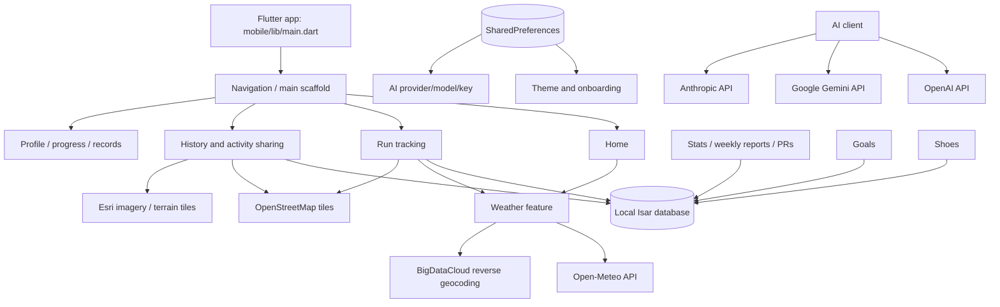

# Trailhead Project Knowledge Graph

> Refreshed 2026-11-24 from the repository after beginning the Riverpod-to-BLoC migration. The migration is partial; verify paths and behavior before changing them.

## Project identity

- **Repository:** Trailhead
- **Application:** Flutter/Dart app in `mobile/` (`trailhead_mobile`)
- **Primary entry point:** `mobile/lib/main.dart`
- **Persistence:** Local Isar database, initialized in `main.dart`; preferences use `shared_preferences`.
- **Current state management:** Hybrid migration. Shared Cubits and modular GetIt initialization are wired at the app root, while many feature screens and async providers still use Riverpod. Do not describe the migration as complete.
- **Backend status:** No first-party backend/API server or Vercel deployment configuration was found in the repository. The root README and `agent_detail.md` contain stale Next.js/Vercel backend assumptions and must not be treated as current architecture.

## System graph

## Feature map

| Feature | Main code | Responsibility / connections |
|---|---|---|
| AI | `mobile/lib/features/ai/` | Shared configuration Cubit, Settings panel and connection Bloc, and typed AI repository. A shared service handles OpenAI, Gemini, and Anthropic requests in native worker isolates. Chat and Predictions reuse it, and older AI callers use the compatibility client. |
| Audio and haptics | `features/audio/`, `features/haptics/` | Each has a global Cubit, a domain feedback use case, and a Flutter platform adapter. Audio groups cues into navigation, action, and alert channels. The navigation sound observer uses the same Audio Cubit as the screens. |
| Chat | `features/chat/` | The route owns a conversation Bloc. The domain builds context from recent activities and handles reply fallback. The repository reads Isar and delegates typed requests to the AI service, which streams replies from a worker isolate on native platforms. |
| Data management | `features/data_management/` | Settings hosts a local Bloc for JSON backup, restore, and bulk GPX export. A repository wraps Isar and file services. JSON encoding and decoding run in a native worker isolate. History and bulk GPX export share the Downloads directory resolver. |
| Goals | `features/goals/` | Goal persistence and goal-setting UI. |
| History | `features/history/` | Run history repository, details, manual entries, charts, GPX export, sharing, route flyover/playback/export. Uses Isar and map tiles. |
| Home | `features/home/` | Main dashboard, summary/progress UI, weather pacing card. |
| Navigation | `features/navigation/`, `shared/navigation/app_navigator.dart` | Main app scaffold plus the shared route push, replacement, pop-until, and page-route builder used by feature screens. |
| Notifications | `features/notifications/` | App startup initializes a DI-managed local notification repository. Its platform service schedules streak nudges using a typed request. Scheduling is available through the repository and has no current caller. |
| Onboarding | `features/onboarding/` | Onboarding UI; completion state is held by the shared `OnboardingCubit`. |
| Predictions | `features/predictions/` | Race estimates and optional AI coach advice. The domain selects a valid baseline and calculates Riegel times. The data adapter reads Isar and uses the existing AI client in a native worker isolate. |
| Profile | `features/profile/` | Settings UI, AI provider/model/key configuration, preferences. |
| Run tracking | `features/run_tracking/` | GPS/background tracking, steps, route, run calculations, Isar models, map widgets, post-run UI. Central cross-feature data source. |
| Shoes | `features/shoes/` | Shoe repository/service, image processing, shoe management/dashboard. |
| Stats | `features/stats/` | Weekly reports, personal record models, calculations, and `AiCoachService`. |
| Weather | `features/weather/` | Current position, weather lookup, reverse-geocoded city, pacing helpers and UI. |
| You | `features/you/` | Progress, activity, and record tabs/screens. |
| Shared | `shared/` | Theme, reusable widgets, global Cubits under `shared/state_management/global/`, and generic local state helpers under `shared/state_management/local/`. |

## External APIs and services

These integrations are called by the Flutter client; no Vercel proxy/API layer is present in the inspected source.

| Service | Endpoint / resource | Caller | Notes |
|---|---|---|---|
| OpenAI | `https://api.openai.com/v1/chat/completions` | `features/ai/application/ai_client.dart` | Chat and streaming requests; bearer key comes from local AI configuration. |
| Google Gemini | `https://generativelanguage.googleapis.com/v1beta/models/{model}:generateContent` and `:streamGenerateContent` | `features/ai/application/ai_client.dart` | API key is passed as query parameter. |
| Anthropic | `https://api.anthropic.com/v1/messages` | `features/ai/application/ai_client.dart` | Chat and streaming requests. |
| Open-Meteo | `https://api.open-meteo.com/v1/forecast` | `features/weather/data/weather_repository.dart` | Current weather fetched using device coordinates. |
| BigDataCloud | `https://api.bigdatacloud.net/data/reverse-geocode-client` | `features/weather/data/weather_repository.dart` | Best-effort city/locality lookup; weather response remains usable if this lookup fails. |
| OpenStreetMap | `https://tile.openstreetmap.org/{z}/{x}/{y}.png` | Run tracking and history map widgets | Map tile resource, not a first-party backend API. |
| Esri | ArcGIS World Imagery and World Topo Map tile URLs | `features/history/presentation/widgets/flyover_3d_map_view.dart` | Satellite and terrain imagery options. |

Image fields also accept HTTP(S) URLs in screens, but the repository does not establish a first-party image-hosting service. No first-party auth, account API, cloud database, or run-sync endpoint was found in the app source scan.

## Local data and state relationships

- `main.dart` opens Isar schemas for runs, run points, shoes, daily steps, personal records, weekly reports, and goals.
- Run tracking writes/reads run data through Isar-backed models; history and stats consume these records.
- Weather is requested from Home and on run completion and can be stored on run records.
- AI credentials/provider/model are read and written through the global `AiConfigCubit` and persisted in `SharedPreferences`.
- Theme, onboarding, navigation, distance unit, and AI configuration have global Cubits under `shared/state_management/global/`.
- `RunTrackerCubit` manages live tracking and is registered in the feature DI module. Goals state uses `GoalsCubit`.
- `AsyncResourceBloc<T>` provides a generic Future/Stream loading pattern for feature-local state, but current feature screens have not yet adopted it broadly.
- Feature-local state management belongs in each feature's `state_management/` directory. Keep dependency lookup in `core/di/` and business workflows in domain use cases; UI screens should only dispatch actions and render state.
- Riverpod remains in `pubspec.yaml` and is still used for multiple feature-local providers and presentation widgets. `ProviderScope` remains in `main.dart`; local BLoC migration is unfinished.
- Dependency registration is split into `core/di/core_module.dart`, `shared_module.dart`, and `feature_module.dart`, orchestrated by `dependency_injection.dart`.

### State-management migration status

| Scope | Current implementation | Notes |
|---|---|---|
| Global theme | `shared/state_management/global/theme_mode_cubit.dart` | Registered from `SharedModule`; initialized from saved preferences. |
| Global onboarding | `shared/state_management/global/onboarding_cubit.dart` | Registered from `SharedModule`; completion persists to preferences. |
| Global navigation | `shared/state_management/global/navigation_cubit_main_tab.dart` | Holds the selected `MainTab`. The scaffold listens for tab changes, preserves the tab stack, and delegates the double-back exit rule to its domain policy. |
| Global distance unit | `shared/state_management/global/distance_unit_cubit.dart` | Registered as a shared Cubit. |
| Global haptics | `shared/state_management/global/haptics_cubit_feedback.dart` | One persisted setting controls UI feedback and run split feedback. |
| Global UI sounds | `shared/state_management/global/audio_cubit_ui_sounds.dart` | One persisted setting controls UI cues, including navigation. The setting is refreshed after a backup restore. |
| Global AI config | `shared/state_management/global/ai_config_cubit.dart` | Used by settings and AI services; persists provider/model/key. |
| Run tracking | `features/run_tracking/application/run_tracker_controller.dart` | Converted to `RunTrackerCubit` and exposed at the app root. |
| Goals | `features/goals/application/goals_cubit.dart` | Converted to `GoalsCubit`; home progress and goal editor consume this state. |
| Feature-local async state | `shared/state_management/local/async_resource_bloc.dart` | Generic Future/Stream BLoC is used by the home coach/trend cards and the post-run summary. |
| Race predictions | `features/predictions/state_management/predictions_bloc_race_predictions.dart` | The route owns its Bloc. Feature DI registers the repository implementation, coach advice service, use case, and Bloc factory. The coach service uses separate request and response models. The screen renders typed results and navigates through AppNavigator. |
| History manual entry | `features/history/state_management/manual_entry_bloc.dart` | Coordinates parsing and saving. `ParseManualRunLog` and `SaveManualRun` use cases own the workflows; domain repository contracts live in `features/history/domain/`, with the Isar adapter registered centrally in `core/di/feature_module.dart`. |

This is an in-progress migration, not a completed Riverpod removal. The app still wraps `TrailheadApp` in `ProviderScope`; many feature-local async providers and Consumer widgets remain, including history, weekly stats/reports, shoes, weather, route display, and activity/records screens. Keep `flutter_riverpod` in the manifest until those call sites are migrated. The next migration work should convert each feature’s provider state to feature-scoped Bloc(s), replace Consumer widgets with BlocBuilder/BlocListener or ordinary Flutter widgets, then remove Riverpod imports, provider declarations, and the root `ProviderScope`.

### Latest migration error cleanup (2026-11-24)

- `RunTrackerCubit.fetchInitialLocation` now checks `isClosed` before emitting after asynchronous location requests; Cubits do not expose a widget `mounted` property.
- Run tracking presentation types now refer to `RunTrackerCubit`, matching the app-wide registration and provider.
- History manual entry resolves `NlLoggingService` through GetIt instead of the removed Riverpod `nlLoggingProvider`; the unused duration controller was removed.
- Generic `AsyncResourceBloc<T>` creates its loading state without `const`, because a const construction cannot use `T` as a type argument.
- VS Code Dart diagnostics refreshed to **0 errors**, 79 warnings, and 112 informational notices after these fixes. This is IDE analyzer status; a full CLI `flutter analyze` did not complete during this session.

## Rules for future Flutter work (user-provided)

1. Every new feature uses Clean Architecture and BLoC state management.
2. Keep business logic in the domain layer. Presentation contains state management and clean UI only.
3. Break code into small methods with simple, understandable names.
4. Name feature files using `feature_name_{layer_role}_{use_case_name}`. Each feature API uses a domain repository contract and separate data files for the implementation, service, request model, and response model.
5. Use global/shared state when multiple features need the same common object.
6. Put reusable components in new files. Generic components may be grouped together in a shared generic file.
7. Preserve existing local conventions where practical, but do not copy the existing Riverpod layering into new feature architecture when it conflicts with these rules.

## Architecture notes and migration caveats

- Existing source is not uniformly Clean Architecture: many features use `application/` and Riverpod, and some services/repos combine responsibilities. Treat this as current-state evidence, not the pattern to extend for new features.
- The manifest currently includes both `flutter_bloc` and Riverpod, plus GetIt for modular dependency registration. `main.dart` initializes `DependencyInjection` and exposes shared Cubits through `MultiBlocProvider`, with a nested `ProviderScope` retained for unmigrated feature-local providers. Remove Riverpod only after remaining consumers/providers have been migrated.
- Vercel removal means there is no currently discovered server-side secret boundary. AI provider keys are stored in `SharedPreferences` and requests are sent directly from the app. Confirm this is an intentional product/security decision before changing AI integration architecture; this graph records behavior, not an endorsement.
- Existing `agent_detail.md` describes planned Next.js routes, Prisma/Supabase, custom auth, Vercel deployment, and requirements that do not match current source. Prefer this file and verified source for current project facts; retain `agent_detail.md` only as historical/planning material until it is reconciled.

## Useful entry points

- Startup and Isar registration: `mobile/lib/main.dart`
- Dependencies/platform stack: `mobile/pubspec.yaml`
- AI endpoints and request formats: `mobile/lib/features/ai/application/ai_client.dart`
- AI settings persistence: `mobile/lib/features/ai/data/ai_repository_implementation_configuration.dart`
- Weather and geocoding endpoints: `mobile/lib/features/weather/data/weather_repository.dart`
- Run tracking controller: `mobile/lib/features/run_tracking/application/run_tracker_controller.dart`
- Existing repository-specific agent guidance: `.agents/AGENTS.md` (includes the sound-on-toggle UI rule)
