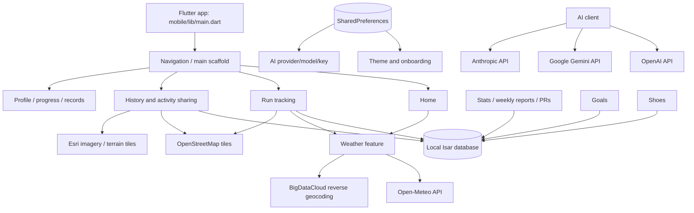

# Trailhead Project Knowledge Graph

> Refreshed 2026-11-24 from the repository. This graph describes the code that exists now; verify paths and behavior before changing them.

## Project identity

- **Repository:** Trailhead
- **Application:** Flutter/Dart app in `mobile/` (`trailhead_mobile`)
- **Primary entry point:** `mobile/lib/main.dart`
- **Persistence:** Local Isar database, initialized in `main.dart`; preferences use `shared_preferences`.
- **Current state management:** Riverpod (`flutter_riverpod`), not BLoC. Existing code should be understood as-is; the requested BLoC rule applies to new features.
- **Backend status:** No first-party backend/API server or Vercel deployment configuration was found in the repository. The root README and `agent_detail.md` contain stale Next.js/Vercel backend assumptions and must not be treated as current architecture.

## System graph

## Feature map

| Feature | Main code | Responsibility / connections |
|---|---|---|
| AI | `mobile/lib/features/ai/application/` | Provider configuration, direct HTTP client for OpenAI, Gemini, and Anthropic. Used by chat, summaries, coaching, and analysis. |
| Audio and haptics | `features/audio/`, `features/haptics/` | Shared sound and haptic feedback; navigation sound observer lives in `shared/navigation/`. |
| Chat | `features/chat/` | AI chat service and chat presentation. Depends on AI configuration/client. |
| Data management | `features/data_management/` | Import/export app/run data. |
| Goals | `features/goals/` | Goal persistence and goal-setting UI. |
| History | `features/history/` | Run history repository, details, manual entries, charts, GPX export, sharing, route flyover/playback/export. Uses Isar and map tiles. |
| Home | `features/home/` | Main dashboard, summary/progress UI, weather pacing card. |
| Navigation | `features/navigation/`, `shared/navigation/app_navigator.dart` | Main app scaffold plus the shared route push, replacement, pop-until, and page-route builder used by feature screens. |
| Notifications | `features/notifications/` | Local notification service. |
| Onboarding | `features/onboarding/` | Onboarding UI and Riverpod state. |
| Predictions | `features/predictions/` | Prediction service and UI. |
| Profile | `features/profile/` | Settings UI, AI provider/model/key configuration, preferences. |
| Run tracking | `features/run_tracking/` | GPS/background tracking, steps, route, run calculations, Isar models, map widgets, post-run UI. Central cross-feature data source. |
| Shoes | `features/shoes/` | Shoe repository/service, image processing, shoe management/dashboard. |
| Stats | `features/stats/` | Weekly reports, personal record models, calculations and providers. |
| Weather | `features/weather/` | Current position, weather lookup, reverse-geocoded city, pacing helpers and UI. |
| You | `features/you/` | Progress, activity, and record tabs/screens. |
| Shared | `shared/` | Theme, reusable widgets, unit provider, navigation utilities. Generic reusable widgets belong here. |

## External APIs and services

These integrations are called by the Flutter client; no Vercel proxy/API layer is present in the inspected source.

| Service | Endpoint / resource | Caller | Notes |
|---|---|---|---|
| OpenAI | `https://api.openai.com/v1/chat/completions` | `features/ai/application/ai_client.dart` | Chat and streaming requests; bearer key comes from local AI configuration. |
| Google Gemini | `https://generativelanguage.googleapis.com/v1beta/models/{model}:generateContent` and `:streamGenerateContent` | `features/ai/application/ai_client.dart` | API key is passed as query parameter. |
| Anthropic | `https://api.anthropic.com/v1/messages` | `features/ai/application/ai_client.dart` | Chat and streaming requests. |
| Open-Meteo | `https://api.open-meteo.com/v1/forecast` | `features/weather/data/weather_repository.dart` | Current weather fetched using device coordinates. |
| BigDataCloud | `https://api.bigdatacloud.net/data/reverse-geocode-client` | `features/weather/data/weather_repository.dart` | Best-effort city/locality lookup; weather response remains usable if this lookup fails. |
| OpenStreetMap | `https://tile.openstreetmap.org/{z}/{x}/{y}.png` | Run tracking and history map widgets | Map tile resource, not a first-party backend API. |
| Esri | ArcGIS World Imagery and World Topo Map tile URLs | `features/history/presentation/widgets/flyover_3d_map_view.dart` | Satellite and terrain imagery options. |

Image fields also accept HTTP(S) URLs in screens, but the repository does not establish a first-party image-hosting service. No first-party auth, account API, cloud database, or run-sync endpoint was found in the app source scan.

## Local data and state relationships

- `main.dart` opens Isar schemas for runs, run points, shoes, daily steps, personal records, weekly reports, and goals.
- Run tracking writes/reads run data through Isar-backed models; history and stats consume these records.
- Weather is requested from Home and on run completion and can be stored on run records.
- AI credentials/provider/model are read and written through `AiConfigNotifier` in `features/ai/application/ai_config_provider.dart`; Settings edits this shared state.
- Theme and onboarding status are initialized from `shared_preferences` at app startup.
- Riverpod providers/controllers currently coordinate asynchronous feature state. Do not describe them as BLoC.

## Rules for future Flutter work (user-provided)

1. Every new feature uses Clean Architecture and BLoC state management.
2. Keep business logic in the domain layer. Presentation contains state management and clean UI only.
3. Break code into small methods with simple, understandable names.
4. Name new files using `feature_name_{directory_to_which_it_belongs}`.
5. Use global/shared state when multiple features need the same common object.
6. Put reusable components in new files. Generic components may be grouped together in a shared generic file.
7. Preserve existing local conventions where practical, but do not copy the existing Riverpod layering into new feature architecture when it conflicts with these rules.

## Architecture notes and migration caveats

- Existing source is not uniformly Clean Architecture: many features use `application/` and Riverpod, and some services/repos combine responsibilities. Treat this as current-state evidence, not the pattern to extend for new features.
- The manifest currently includes Riverpod and Dio; it does not include `flutter_bloc`. New BLoC work may require adding that dependency, subject to the project’s dependency workflow.
- Vercel removal means there is no currently discovered server-side secret boundary. AI provider keys are stored in `SharedPreferences` and requests are sent directly from the app. Confirm this is an intentional product/security decision before changing AI integration architecture; this graph records behavior, not an endorsement.
- Existing `agent_detail.md` describes planned Next.js routes, Prisma/Supabase, custom auth, Vercel deployment, and requirements that do not match current source. Prefer this file and verified source for current project facts; retain `agent_detail.md` only as historical/planning material until it is reconciled.

## Useful entry points

- Startup and Isar registration: `mobile/lib/main.dart`
- Dependencies/platform stack: `mobile/pubspec.yaml`
- AI endpoints and request formats: `mobile/lib/features/ai/application/ai_client.dart`
- AI settings persistence: `mobile/lib/features/ai/application/ai_config_provider.dart`
- Weather and geocoding endpoints: `mobile/lib/features/weather/data/weather_repository.dart`
- Run tracking controller: `mobile/lib/features/run_tracking/application/run_tracker_controller.dart`
- Existing repository-specific agent guidance: `.agents/AGENTS.md` (includes the sound-on-toggle UI rule)
